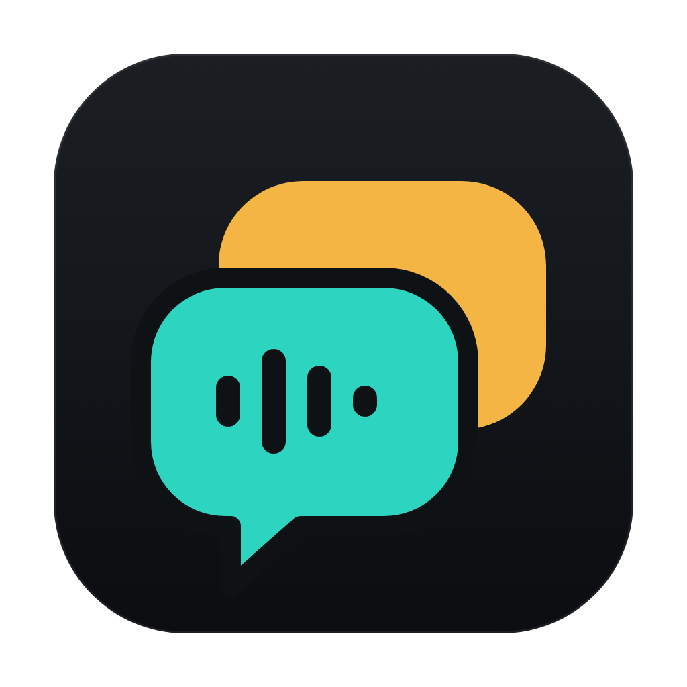

<div align="center">
  
  <h1>Parley</h1>
  <p><strong>Record your calls on macOS, get searchable transcripts, and ask Claude about them.</strong></p>
</div>

Parley records two tracks during a meeting: your microphone and the call audio your Mac plays (Zoom, Meet, Teams, Slack huddles, in the browser or the native app). When you stop, it transcribes both, merges them into one time-ordered transcript with speaker labels, stores everything locally, and makes it available to Claude through an MCP server.

The mic track is labelled "Me" and the call track "Them", so you get speaker labels without guessing. With Gladia, the call track is also split into "Them 1", "Them 2" and so on.

Transcription runs against local Ollama by default; Groq, OpenAI and Gladia work through profiles. Audio is written to disk while you record, so a crash or a restart mid-call keeps everything up to that point. Every meeting gets a `transcript.md` with YAML front matter, and `parley-mcp` lets Claude list, search and read your meetings.

## Requirements

- macOS **14.2 or later** for call audio (Core Audio process taps). On older macOS only the mic is recorded.
- A transcription backend, one of:
  - [Ollama](https://ollama.com) running locally with a speech model (default profile: `gemma4:e4b` at `http://localhost:11434/v1`), or
  - any OpenAI-compatible `/audio/transcriptions` endpoint (Groq, OpenAI) with an API key, or
  - a [Gladia](https://app.gladia.io/) API key.
- To build: Node.js 20.19+, Rust stable, Xcode command-line tools.

## Build and run

```bash
npm ci
npm run tauri:build
```

The app bundle is written to `src-tauri/target/release/bundle/macos/Parley.app` (and a `.dmg` next to it). Copy it to `/Applications`. The bundle contains both binaries: `Parley.app/Contents/MacOS/parley` (the app) and `Parley.app/Contents/MacOS/parley-mcp` (the MCP server). Builds are ad-hoc signed.

For development:

```bash
npm run tauri:dev     # app with hot reload (identifier in.villarejo.parley.dev)
npm run build:mcp     # builds src-tauri/target/release/parley-mcp
```

## Permissions

| Permission | Why | When macOS asks |
| --- | --- | --- |
| Microphone | Your voice, the "Me" track | First recording, or **Permissions → Grant** |
| System Audio Recording | The other participants, the "Them" track | First recording, or **Permissions → Ask now** |

If System Audio Recording is denied, macOS still lets Parley start but hands it silence. Parley warns you in the recorder and on the meeting. Turn it on under **System Settings → Privacy & Security → Screen & System Audio Recording → System Audio Recording Only**.

Use headphones on calls. Without them the mic also picks up the call. Parley drops "Me" segments that repeat what "Them" said at the same moment, but headphones give a cleaner result.

> [!IMPORTANT] Recording a conversation can require the consent of everyone in it, depending on where you and they are. Parley never records on its own. While it records, the menu bar icon turns into a red dot and the recorder window shows **REC**.

## Using it

Start a recording from the menu bar icon, the Record meeting button in the library, the floating recorder, or the global shortcut <kbd>⌥⇧⌘R</kbd> (change it in Recording & storage).

The recorder is a small window that stays on top, shows on every Space and doesn't take focus from your call. It has the timer, level meters for Me and Them, an editable title, buttons to mark a highlight or add a note, pause/resume and stop. Closing it with × doesn't stop the recording; reopen it from the menu bar.

When you stop, the meeting is transcribed with the active profile. Its status goes from recording to transcribing to ready. If it fails, the meeting shows the error and a Retry button.

The library searches titles and transcript text. Click a timestamp or a sentence to play from there. You can switch playback between both tracks, Me or Them, rename the meeting, re-transcribe it with another profile, copy the transcript as Markdown, show the folder in Finder, or delete it.

## Highlights and notes

During a call you can flag the moments that matter. Claude treats them as your own signal of what to prioritise.

In the recorder, the star button marks a highlight at the current recording time. The recorder confirms it ("Marked 12:34") and the star shows how many you have marked so far. The note button opens a short text field. The note is stamped with the moment the field opened, so you can keep listening while you type. Enter saves it, Esc cancels.

You can also stay in the call app: <kbd>⌥⇧⌘M</kbd> marks a highlight and <kbd>⌥⇧⌘N</kbd> opens the note field. Both are registered only while a recording runs. Change them or turn them off in **Recording & storage**.

Clicking the recorder doesn't take focus from your call app. The recorder takes the keyboard only while you type a title or a note, and hands it back when you press Enter or Esc.

Each highlight or note is saved to the database as soon as you make it, so it survives a crash mid-call like the audio does. Times use the recording clock: paused time doesn't count, and they line up with the transcript. They belong to the meeting, so re-transcribing keeps them.

In the library they sit inline in the transcript at their time. Click one to play from there. You can edit a note, delete a highlight or a note, and add new ones at the current playback position after the meeting.

## Connect Claude

`parley-mcp` is a stdio MCP server with read-only access to the same database the app uses. It follows the app's storage setting, so there is nothing to configure.

**Claude Code:**

```bash
claude mcp add parley -- /Applications/Parley.app/Contents/MacOS/parley-mcp
```

**Claude Desktop:** add this to `~/Library/Application Support/Claude/claude_desktop_config.json` and restart Claude Desktop:

```json
{
  "mcpServers": {
    "parley": {
      "command": "/Applications/Parley.app/Contents/MacOS/parley-mcp",
      "args": []
    }
  }
}
```

The **Connect Claude** screen in the app shows both snippets with the exact path of your install and copy buttons. For a development build, use `src-tauri/target/release/parley-mcp` after `npm run build:mcp`.

Tools:

| Tool | Arguments | Returns |
| --- | --- | --- |
| `list_meetings` | `from`, `to` (`YYYY-MM-DD` local day or RFC 3339), `query`, `limit` | meetings, newest first |
| `get_meeting` | `id` | title, start/end, duration, status, speakers, file paths, highlights and notes |
| `get_transcript` | `id`, `format` = `markdown` (default) or `segments` | the `transcript.md` document, or timestamped segments and markers as JSON |
| `search_transcripts` | `query`, `limit` | snippets with meeting id, speaker and timestamp |
| `list_highlights` | `meeting_id`, `from`, `to`, `kind` = `highlight` or `note`, `limit` | highlights and notes across meetings (newest meeting first), each with meeting title, timestamp, note text and the transcript within 30 s either side |

The server's instructions tell Claude that highlights and notes are your explicit signal of what matters, and to put them first in summaries, decisions and action items.

Each meeting is also an MCP resource, `parley://meeting/{id}` (`text/markdown`). Run `parley-mcp --help` for the options (`--db <path>` or `PARLEY_DB` to use another database, `--print-db` to show which one it uses).

## Where things are stored

By default everything lives in `~/Library/Application Support/parley/`:

```text
config.json                 profiles, API keys, languages, vocabulary, mic, shortcuts
parley.db                   SQLite (WAL): meetings, segments, highlights and notes, FTS5 search index
meetings/<id>/mic.wav       16 kHz mono, your mic
meetings/<id>/system.wav    16 kHz mono, the call audio
meetings/<id>/mixed.wav     both tracks mixed, for playback
meetings/<id>/transcript.md the transcript with YAML front matter
```

**Recording & storage → Move to another folder…** moves the database and the meeting folders to an empty folder of your choice. `config.json` stays put and records the new location. Set `PARLEY_HOME` to use a completely separate profile (handy for development).

A `transcript.md` looks like this:

```markdown
---
title: "Q4 budget review"
id: "20261008-140200-3fa1"
date: 2026-10-08T14:02:00+02:00
duration: "00:45:12"
duration_seconds: 2712
participants: ["Me", "Them 1", "Them 2"]
status: ready
markers: 2
transcribed_with: "Gladia"
source: Parley
---

# Q4 budget review

_Thursday, 8 October 2026, 14:02 · 45 min · Me, Them 1, Them 2_

## Highlights & notes

- ⭐ **Highlight** [00:00:08]
- 📝 **Note** [00:00:57]: Send Finance the reserved-capacity numbers by Friday

> Speaker labels come from the audio source: **Me** is the local microphone, **Them** is the call audio.

## Transcript

**Me** [00:00:02] Thanks for making time. I'd like to close the Q4 budget today.

> ⭐ **Highlight** [00:00:08]

**Them 1** [00:00:08] Sure. Finance signed off on the headcount plan…
```

Highlights and notes use one line each: `⭐ **Highlight** [HH:MM:SS]` and `📝 **Note** [HH:MM:SS]: text`. They appear twice: as a list after the title, and as a `>` quote inside the transcript, before the first sentence spoken at or after their time (so a marker can split a turn). `markers` in the front matter counts them. The list and the `## Transcript` heading are only there when the meeting has markers.

## Transcription

Profiles from TTM carry over: you can keep several (two Ollama servers, Groq, a Gladia account) and switch the active one in **Transcription**. Languages and custom vocabulary are shared by all profiles. Leave languages empty to let the provider detect the language.

- OpenAI-compatible (Ollama, Groq, OpenAI): each track is split into utterances by voice activity detection (pauses of about a second, at most 28 s each, since Gemma-class models accept 30 s of audio). Each utterance is one request and becomes one timestamped segment. Silence is never sent, which avoids invented text on silent stretches. Rate limits (429) and server errors are retried with backoff. Vocabulary terms are passed as the `prompt`.
- Gladia: each track is uploaded and transcribed with the pre-recorded API, in pieces of at most an hour. The call track uses diarization. Vocabulary, intensity and pronunciations map to Gladia's custom vocabulary.

Then both tracks are merged by time, labelled Me / Them, written to the database and to `transcript.md`.

## Architecture

| Area | Technology | Location |
| --- | --- | --- |
| Desktop shell | Tauri 2 | `src-tauri/` |
| App backend | Rust, Tokio, CPAL, Core Audio | `src-tauri/src/main.rs` and modules |
| Shared core (app + MCP) | Rust library `parley_lib` | `src-tauri/src/lib.rs` |
| MCP server | Rust binary `parley-mcp` | `src-tauri/src/bin/parley-mcp.rs` |
| UI | React 19, TypeScript, Vite | `src/` (main window), `src/widget/` (recorder) |

```text
mic (CPAL) ──────────────► recorder ─► meetings/<id>/mic.wav ─┐
system audio (process tap) ► recorder ─► meetings/<id>/system.wav ─┤ stop
                                                                    ▼
                    VAD + OpenAI-compatible, or Gladia pre-recorded (per track)
                                                                    ▼
                    merge (Me / Them, echo filter) ─► parley.db (FTS5) + transcript.md
                                                                    ▼
                                   parley-mcp (read-only) ─► Claude
```

Backend modules:

- `audio.rs`: microphone capture via CPAL, resampled to 16 kHz mono (from TTM)
- `system_audio.rs`: Core Audio process tap (`CATapDescription`, global stereo tap excluding Parley's own process) plus a private aggregate device and an IOProc
- `recorder.rs`: the recording clock (pause aware), per-track WAV writers, level meters
- `transcribe.rs`, `batch_stt.rs`, `gladia.rs`: the transcription pipeline and providers
- `library.rs`: meeting folders, `transcript.md`, deletion, crash recovery, storage moves
- `config.rs`, `vocabulary.rs`: settings and profiles (from TTM)
- `parley_lib`: `store` (SQLite + FTS5), `wav` (crash-tolerant WAV), `vad`, `merge`, `markdown`, `mcp`, `paths`

### Why Core Audio taps

Process taps (macOS 14.2+) capture what other apps play without a virtual audio driver and without screen-recording permission. They only need the narrower "System Audio Recording" permission, and they don't touch what you hear. ScreenCaptureKit audio-only capture was the fallback option, but taps worked, so it isn't used.

### Crash safety

Each track is written straight to its WAV file. The header is rewritten every 2 seconds and the file is fsynced every 10 seconds, so a crash loses at most a few seconds. On launch, meetings still marked _recording_ get their headers repaired from the file length, are closed, and are marked _failed_ with a note. **Retry** transcribes the recovered audio. Choosing **Quit** while recording finalizes the files first.

## Development

| Command | Purpose |
| --- | --- |
| `npm run tauri:dev` | Run the app (dev identifier, hot reload) |
| `npm run dev` | Vite only; `/screenshots.html` is the UI gallery with mock data |
| `npm test` | `cargo test` (unit + MCP integration tests), Vitest, `tsc --noEmit` |
| `npm run format` / `format:check` | Prettier + rustfmt |
| `npm run build` | Frontend bundle |
| `npm run build:mcp` | Release build of `parley-mcp` |
| `npm run tauri:build` | App bundle + DMG (includes `parley-mcp`) |
| `npm run screenshots` | With `npm run dev` running: capture the gallery to `~/parley-screenshots` and run UI smoke checks |
| `npm run icons` | Re-render the icon set from `design/*.svg` |

The MCP integration tests (`src-tauri/tests/mcp_integration.rs`) start the real `parley-mcp` binary against a temporary database and exercise every tool and resource over stdio. A real-Ollama check is available as an ignored test: `PARLEY_STT_WAV=/path/to/16k-mono.wav cargo test --manifest-path src-tauri/Cargo.toml -- --ignored ollama --nocapture`.

## Credits

Parley is derived from [TTM](https://github.com/mvillarejo/ttm), itself a fork of [GladiaFlow](https://github.com/gladiaio/gladiaflow) by Gladia (MIT). The microphone capture, the transcription profiles and the OpenAI-compatible client come from there. The original copyright notice is kept in [LICENSE](LICENSE); see also [NOTICE](NOTICE).

Parley is not an official Gladia product and is not affiliated with or endorsed by Gladia. See [TRADEMARKS.md](TRADEMARKS.md).

## License

[MIT](LICENSE). Copyright (c) 2026 Gladia, Copyright (c) 2026 Manuel Villarejo.
